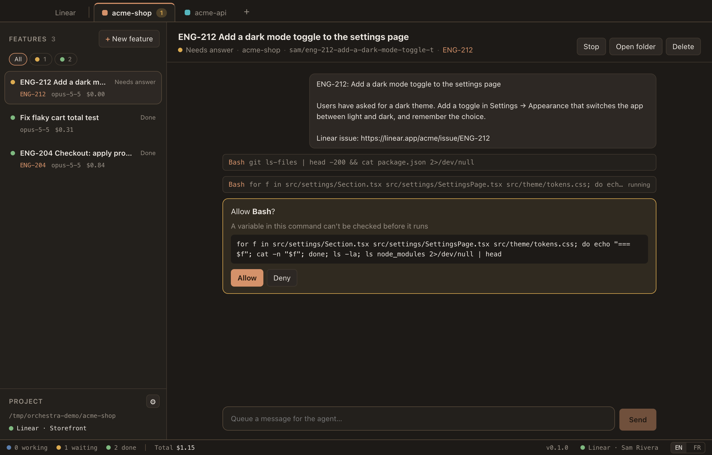
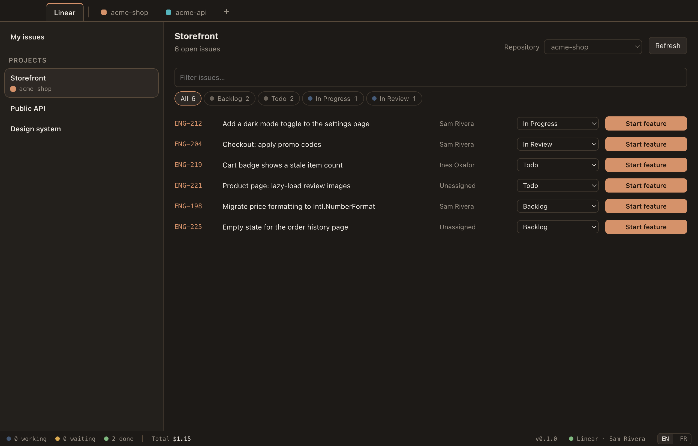

<div align="center">


# Guru

**Run several Claude Code agents at once, one per feature, without losing track of any of them.**

[](https://github.com/NoahSmo/Baton/actions/workflows/ci.yml)
[](https://github.com/NoahSmo/Baton/releases/latest)
[](LICENSE)


[Install](#install) · [Quick start](#quick-start) · [Features](#features) · [Docs](#how-it-works) · [Contributing](#contributing)



</div>

Guru (formerly Baton) is a desktop app for people who work with several [Claude Code](https://claude.com/claude-code) agents in parallel. You do not manage terminals or worktrees: you create a **feature**, and it gets its own agent, its own branch and its own git worktree. The app shows which agents are working, which are done and which are waiting for you.

> [!NOTE]
> Independent project, not affiliated with Anthropic.

## Contents

- [Features](#features)
- [Install](#install)
- [Quick start](#quick-start)
- [Going easy on your usage limit](#going-easy-on-your-usage-limit)
- [How it works](#how-it-works)
- [Linear (optional)](#linear-optional)
- [Themes](#themes)
- [Updates](#updates)
- [Data and privacy](#data-and-privacy)
- [Contributing](#contributing)
- [Limitations](#limitations)
- [License](#license)

## Features

### Orchestrate

- **One agent per feature.** Each runs in its own git worktree, on its own branch, so agents never step on each other.
- **Projects in a rail, in your order.** Drag projects to reorder them, gather them in **groups** that fold away, and see at a glance which ones have an agent waiting. Everything is also reachable from the right-click menu.
- **A status you can read at a glance.** Working, needs answer, done, error, usage limit. Filter by status, sort by activity or date, pin, archive.
- **Answer from the app.** Permission requests and the agent's questions appear as cards: allow, always allow, deny, or pick an option. `⌘⏎` allows the first one.
- **Several Claude accounts.** Log in to more than one, pin projects to accounts, and fail over between them.
- **Presets and permissions on the fly.** Pick a model, effort and permission mode (Ask, Accept edits, Plan, Bypass) per agent, or save the combination as a preset. Change it in the middle of a turn.

### Review and ship

- **Readable conversations.** Markdown, live streaming, tool calls folded into one line per run with a spinner, tick or cross, a **Latest** button when you scroll up, cost per turn and per feature. Sessions survive restarts.
- **A built-in editor.** The feature's worktree next to the conversation: file tree, tabs, syntax highlighting, `⌘S`. Create, rename and delete files and folders from the tree (deleted ones go to the system trash). Files follow what the agent writes, and you are asked before anything is overwritten.
- **Git at a glance.** Branch, commits to push or pull, changed files. The **Changes** tab switches between "since the last commit" and "last turn".
- **Pull requests.** **Create PR** next to Commit and Push: Claude drafts the title and description from the branch, you edit them, `gh` opens it. The **PR & CI** tab then shows the state, checks and review, and merges it (squash, merge commit or rebase) once it is ready.
- **Continue in a new agent.** On a heavy conversation, Claude sums up the work and a new agent carries on from a branch cut from the old one.
- **Terminals and launch commands.** Shells at the bottom of the window (`` ⌃` ``), plus one-click project commands (dev server, tests…) run in the worktree on screen.
- **Automatic tests.** Give a project a test command and it runs when an agent finishes, with a recap of the output.

### Stay in control

- **Notifications you choose.** Per event, with or without sound, and a count on the Dock icon on macOS.
- **Context at a glance.** The gauge in the feature's header shows how full the agent's context window is; click it for what fills it (messages, tools, MCP servers, memory files, skills), as `/context` reports it.
- **Usage overview.** Click the total in the status bar for the cost per day, project and agent. See [below](#going-easy-on-your-usage-limit) for how Guru spares your limit.
- **Search and shortcuts.** `⌘N` new agent, `⌘J` next agent waiting, `⌘[` `⌘]` previous or next, `⌘1…9` project (in rail order), `⌘E` editor, `⌘F` search the conversation, `⌘⇧F` search the agents. `Ctrl` outside macOS; all listed in Settings.
- **A message box that remembers.** Drafts per agent, `↑` / `↓` for earlier messages, per-project **Prompts**, and Claude Code slash commands (`/compact`, `/model`, `/context`…).
- **A trash for deleted agents.** Uncommitted changes are kept 7 days and can be restored from Settings.
- **English and French**, and a [handful of themes](#themes).

## Install

On every system you need [Git](https://git-scm.com) and [Claude Code](https://claude.com/claude-code) installed and logged in (run `claude` once). The app uses that login and never asks for an Anthropic key.

### macOS

Apple Silicon, macOS 13 or later.

```sh
brew install --cask noahsmo/tap/baton
```

> [!IMPORTANT]
> The build is not notarized by Apple. The cask clears the quarantine flag so macOS lets the app open. If you download the zip from the [releases page](https://github.com/NoahSmo/Baton/releases) instead, run this yourself:
>
> ```sh
> xattr -dr com.apple.quarantine /Applications/Guru.app
> ```

### Linux

x64 or arm64.

```sh
curl -fsSL https://raw.githubusercontent.com/NoahSmo/Baton/main/install.sh | sh
```

The script installs the `.deb` on Debian and Ubuntu, the `.rpm` on Fedora and openSUSE (both through `sudo`), and otherwise unpacks the app in `~/.local/share/baton` with a `baton` command and a menu entry. Read [the script](install.sh) first if you prefer.

<details>
<summary>Options and manual install</summary>

- Force the rootless install with `BATON_INSTALL=user`; pin a version with `BATON_VERSION=0.3.0`.
- Or take a package from the [releases page](https://github.com/NoahSmo/Baton/releases):

  ```sh
  sudo apt install ./Guru-<version>-linux-amd64.deb     # Debian, Ubuntu
  sudo dnf install ./Guru-<version>-linux-x86_64.rpm    # Fedora
  ```

- Homebrew on Linux does not install desktop apps, hence the script.
- The Linear key is stored with the Secret Service (GNOME Keyring, KWallet…). Without one running, Linear cannot be connected.

</details>

## Quick start

1. Click **New project** and choose the root folder of a git repository. Pick a name, a color, an image if you like.
2. Click **New agent**. Give it a title and say what it should do.
3. Choose how much it may do on its own:

   | Mode | The agent |
   |---|---|
   | Ask | asks before every edit and command |
   | Accept edits | edits files freely, asks before commands |
   | Plan | explores and proposes a plan before changing anything |
   | Bypass | never asks. Use it only on work you can throw away |

4. Watch it in the sidebar. When its dot turns amber, the agent is waiting for you.
5. When it is done, review in the editor, or open the worktree (right-click → **Open folder** / **Open in Terminal**), test and push the branch.

**Organise the rail.** Drag a project to move it. Right-click one and choose **Move to a new group**, then drag others onto the group's label. Click the label to fold or unfold the group; a folded group still shows how many agents wait inside.

## Going easy on your usage limit

Every request an agent makes sends its whole conversation again. A conversation of 300k tokens read 30 times adds up fast, several agents at once even faster. Guru keeps that in check:

| Lever | What it does |
|---|---|
| **Sonnet by default** | Pick another model per agent (Haiku, Opus, Opus Plan, Fable) when you need it. Opus uses the limit several times faster. |
| **A cap on agents at once** | **At once** in the status bar: 1, 2 (default), 3 or ∞. Extra messages are queued, and when the limit is hit the queue waits for the reset. |
| **No full price for picking up a conversation** | After an hour of quiet, a conversation over 60k tokens is summarised (`/compact`) before it is resumed, instead of being re-sent in full. |
| **The size in sight** | The context gauge in the feature's header turns amber past 100k (time to continue in a new agent) and breaks the window down by category. |
| **A warning before the wall** | A notification, and the status bar says when the window resets. |

## How it works

- A feature's worktree lives in `~/.baton/worktrees/`, on a new branch cut from the repository's current `HEAD`: `feat/<title>`, or the branch name Linear suggests when the feature comes from an issue.
- Untracked `.env*` files at the repository root are copied into the new worktree.
- Agents run through the Claude Agent SDK with your Claude Code settings, `CLAUDE.md` files, plugins, hooks and MCP servers. Everything they load is sent with every request, so a lean `~/.claude` makes every agent cheaper.
- Deleting a feature removes its worktree, uncommitted changes included (kept in the trash), and keeps the branch. The app asks first.
- **A merged feature removes itself** when its branch is on a remote default branch (`main`, `master`, `dev`, `develop`), its worktree is clean and it has been quiet for an hour. Checked at startup and every 15 minutes.
- Removing a project only forgets it: nothing on disk is touched.

## Linear (optional)

The app works without Linear, and each project decides whether it is linked. Until you connect an account, the only trace is a **Connect Linear** button in the status bar. Paste a personal API key (Linear → Settings → Security & access → Personal API keys); it is stored encrypted with the system keychain.



- **Link a repository to Linear projects** from the project settings. One repository can serve many Linear projects; repositories you do not link never show any issue.
- **Start a feature from an issue.** It takes the issue's title, description and link as its first prompt, and the branch name Linear suggests, so Linear attaches the pull request to the issue. The issue moves to its team's first started state.
- **Create and read issues** from the new agent dialog and the Linear tab, which lists projects and their open issues with state filters and a detail view.

## Themes

Studio (default), Baton, Graphite, Fjord, Rosy Dark, Wesur Dark, light themes (Latte, Snow, Rosy, Wesur), **Teenage Engineering** in light and dark, and your own: Settings has a color editor for custom themes, and lets you pick the app icon: the guru in 32-bit (default), 16-bit or 8-bit, or the classic Baton stick.

## Updates

The app checks GitHub for a release at startup and every six hours. **Update to x.y.z** then appears in the status bar. With Homebrew, **Update and restart** runs `brew upgrade` and reopens the app (running agents stop; their conversations resume when you message them). Otherwise the dialog gives you the command. From a terminal:

```sh
brew upgrade --cask noahsmo/tap/baton                                             # macOS
curl -fsSL https://raw.githubusercontent.com/NoahSmo/Baton/main/install.sh | sh  # Linux
```

## Data and privacy

Everything stays on your machine, in `~/.baton/` (override with `BATON_DATA_DIR`).

| Path | Content |
|---|---|
| `state.db` | projects, features and conversation history (SQLite) |
| `worktrees/` | one git worktree per feature |
| `settings.json` | language, theme, app icon, agents allowed at once, notifications |
| `trash/` | uncommitted changes of deleted agents, for 7 days |
| `linear.key` | your Linear API key, encrypted with the system keychain |
| `update.log` | output of the last Homebrew upgrade |

The rail's layout (order and groups) is kept in the app's local storage. Guru talks to three services: Anthropic through Claude Code, Linear only if you connect it, and GitHub to check for updates. **There is no telemetry.**

## Contributing

Requires Node 22 or later.

```sh
npm install
npm run dev         # run the app with hot reload
npm test            # unit tests (vitest)
npm run typecheck
npm run dist        # build Guru-<version>.zip in dist/ (on a Mac)
npm run dist:linux  # build .deb, .rpm and .tar.gz in dist/ (on Linux)
npm run icon        # regenerate the icons from build/guru-*/source.png and build/classic/icon.svg
```

The renderer reloads on save; restart `npm run dev` after changing anything under `src/main`. Pull requests are welcome: run `npm test` and `npm run typecheck` first.

<details>
<summary>Project layout</summary>

| Path | Role |
|---|---|
| `src/main/agent.ts` | one Claude Code process per feature |
| `src/main/manager.ts` | projects, features, event journal, agent queue |
| `src/main/worktree.ts` | git worktree lifecycle |
| `src/main/linear.ts` | Linear GraphQL client |
| `src/main/updater.ts` | release check and Homebrew upgrade |
| `src/main/menus.ts` | context menu contents |
| `src/main/files.ts` | editor file access, confined to a worktree, and change watching |
| `src/main/terminals.ts` | terminal panel shells (node-pty) |
| `src/shared/status.ts` | feature status as a pure function of its events |
| `src/shared/railLayout.ts` | rail order and groups, as pure functions |
| `src/shared/themes.ts` | built-in themes and custom-theme validation |
| `src/shared/i18n.ts` | every user-facing string, in both languages |
| `src/renderer/` | React interface |

</details>

<details>
<summary>Releasing</summary>

Versions follow [semantic versioning](https://semver.org). A release is published on demand (Actions → Release → Run workflow) through [GitHub Actions](.github/workflows/release.yml): it runs the checks, builds the macOS zip and the Linux packages for x64 and arm64, creates the GitHub release and updates the Homebrew cask.

The version is the latest release plus one patch. For a minor or major release, raise `version` in `package.json` in your commit (`npm version 0.4.0 --no-git-tag-version`): when it is ahead of the latest release, that exact version is published. CI never commits back to `main`.

One-time setup: a `HOMEBREW_TAP_TOKEN` repository secret, a fine-grained token with *Contents: read and write* on `NoahSmo/homebrew-tap`. Without it the release is published but the cask is not updated.

Each Linux package is built on a runner of its own architecture, since node-pty has to be compiled there. `scripts/build-linux.sh` does the same locally, in Docker.

</details>

## Limitations

- macOS on Apple Silicon only; no Windows build.
- Not notarized: install through Homebrew, or clear the quarantine flag yourself.
- The download is about 230 MB, because it bundles the Claude Code runtime.
- Linux packages are tried less than the macOS app.
- Unsaved editor changes and open terminals do not survive quitting the app.
- A feature stopped by the usage limit continues in a new agent after the reset only if automatic continuation is on in Settings.

## License

[MIT](LICENSE)
