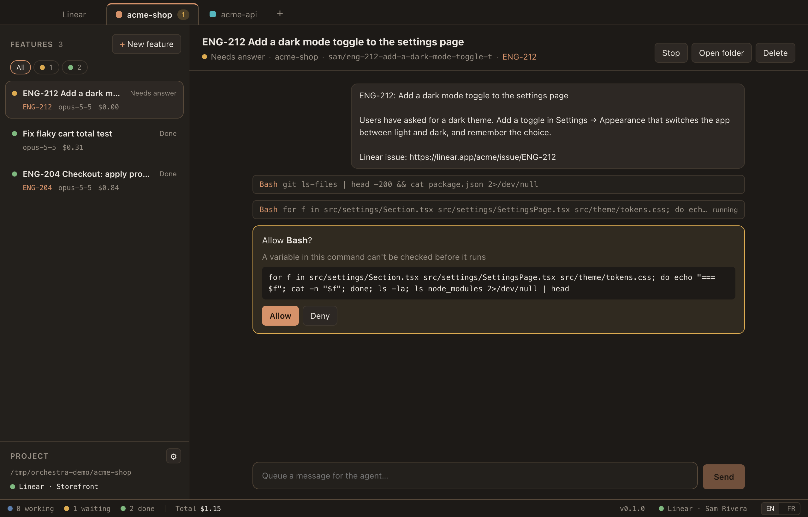
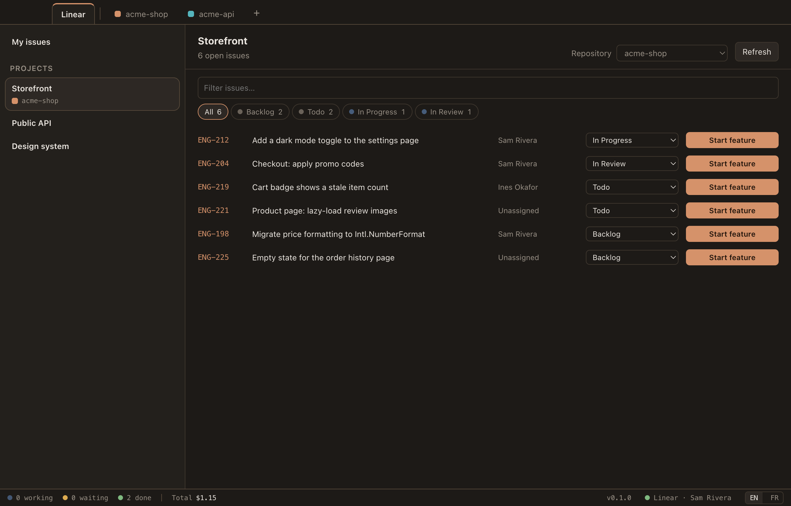

<p align="center">
  
</p>

<h1 align="center">Baton</h1>

<p align="center">
  Run several Claude Code agents at once, one per feature, without losing track of any of them.
</p>



Baton is a desktop app, for macOS and Linux, for people who work with several Claude Code agents in parallel. You do not manage terminals or worktrees: you create a **feature**, and it gets its own agent, its own branch and its own git worktree. The app shows which agents are working, which are done and which are waiting for you.

Independent project, not affiliated with Anthropic.

## Contents

- [Features](#features)
- [Install](#install)
- [Quick start](#quick-start)
- [Going easy on your usage limit](#going-easy-on-your-usage-limit)
- [How it works](#how-it-works)
- [Linear (optional)](#linear-optional)
- [Updates](#updates)
- [Data and privacy](#data-and-privacy)
- [Development](#development)
- [Limitations](#limitations)

## Features

- **One agent per feature.** Each feature runs Claude Code in its own git worktree, on its own branch, so agents never step on each other.
- **Projects as tabs.** One tab per repository, with its color and a badge when an agent needs an answer.
- **A status you can read at a glance.** Working, needs answer, done, error, usage limit. Filter the list by status.
- **Answer from the app.** Permission requests and the agent's questions show up as cards: allow, always allow, deny, or pick an option.
- **Notifications** when an agent needs you or finishes, with a count on the Dock icon on macOS.
- **Readable conversations.** Markdown, live streaming, collapsible tool calls with their input and output, cost per turn and per feature.
- **Sessions survive restarts.** Quit the app, reopen it, send a message: the agent resumes the same conversation.
- **A built-in editor.** The **Editor** button opens the feature's worktree next to the conversation: file tree, tabs, syntax highlighting, `⌘S`. Files follow what the agent writes; if it rewrites one you are editing, you are asked before anything is overwritten.
- **Git at a glance.** The feature's header shows its branch, the commits to push or pull and the number of changed files. Click the branch to switch the worktree to another one; the editor's **Changes** tab lists what differs from the last commit, and the file tree colors it.
- **A terminal panel.** **Terminal** (or `⌃\``) opens shells at the bottom of the window, in the project's folder or in the feature's worktree. They keep running while you switch tabs, and the sidebar lists them.
- **Launch commands.** Give a project its usual commands (dev server, tests…) under **Launch** in the sidebar: one click runs one in a new terminal, in the worktree of the feature on screen.
- **Change permissions on the fly.** Switch a feature between Ask, Accept edits, Plan and Bypass under the message box, in the middle of a turn too.
- **Go easy on your usage limit.** Sonnet by default, a cap on agents running at once, long conversations summarised before they are picked up again, and a warning before the limit hits. See [below](#going-easy-on-your-usage-limit).
- **Keyboard shortcuts.** `⌘N` new agent, `⌘J` next agent waiting for you, `⌘[` / `⌘]` previous or next agent, `⌘1…9` project, `⌘E` editor, `⌘⏎` allow the first pending request, `⌘F` search the conversation, `⌘⇧F` search the agents (`Ctrl` outside macOS). Listed in Settings.
- **Find and organise.** Search agents by title, branch or issue, sort them by status, activity or date, pin the ones you need, archive the finished ones. A queued agent shows its place in line, and can jump it from the right-click menu.
- **A message box that remembers.** What you typed stays with each agent, `↑` / `↓` bring back earlier messages, and each project can keep ready-made **Prompts** inserted with one click.
- **Pull requests.** **Create PR** next to Commit and Push: Claude drafts the title and description from the branch, you edit them, `gh` opens it.
- **Continue in a new agent.** On a heavy conversation, Claude sums up the work and a new agent carries on from a branch cut from the old one, with the uncommitted changes.
- **What the last turn changed.** The editor's **Changes** tab switches between "since the last commit" and "last turn".
- **Usage overview.** Click the total in the status bar for the cost per day, project and agent.
- **A trash for deleted agents.** Uncommitted changes are kept 7 days and can be restored from Settings.
- **Notifications you choose.** Per event, with or without sound, and optionally also while the app is in front for agents you are not looking at.
- **Right-click everything.** Open the worktree in your file manager (or Terminal on macOS), copy the branch name, rename, stop, delete.
- **English and French**, switched from the status bar.
- **Linear, if you use it.** Start features straight from your issues, and link each repository to a Linear project label so issues know where to go.

## Install

On every system you need [Git](https://git-scm.com), and [Claude Code](https://claude.com/claude-code) installed and logged in (run `claude` once). The app uses that login; it never asks for an Anthropic key.

### macOS

Apple Silicon, macOS 13 or later.

```sh
brew install --cask noahsmo/tap/baton
```

The build is not notarized by Apple. The cask clears the quarantine flag so macOS lets the app open. If you download the zip from the [releases page](https://github.com/NoahSmo/Baton/releases) instead, you have to do that yourself:

```sh
xattr -dr com.apple.quarantine /Applications/Baton.app
```

### Linux

x64 or arm64.

```sh
curl -fsSL https://raw.githubusercontent.com/NoahSmo/Baton/main/install.sh | sh
```

The script installs the `.deb` on Debian and Ubuntu, the `.rpm` on Fedora and openSUSE (both through `sudo`), and otherwise unpacks the app in `~/.local/share/baton` with a `baton` command and a menu entry. Force that last way, without root, with `BATON_INSTALL=user`; pin a version with `BATON_VERSION=0.2.0`. Read [the script](install.sh) first if you prefer, or take a package from the [releases page](https://github.com/NoahSmo/Baton/releases):

```sh
sudo apt install ./Baton-<version>-linux-amd64.deb     # Debian, Ubuntu
sudo dnf install ./Baton-<version>-linux-x86_64.rpm    # Fedora
```

Homebrew on Linux does not install desktop apps, hence the script.

The Linear key is stored with the Secret Service (GNOME Keyring, KWallet…); without one running, Linear cannot be connected.

## Quick start

1. Open the app and click **New project**. Choose the root folder of a git repository, pick a name and a color.
2. Click **New feature**. Give it a title and say what the agent should do.
3. Choose how much the agent may do on its own:

   | Mode | The agent |
   |---|---|
   | Ask | asks before every edit and command |
   | Accept edits | edits files freely, asks before commands |
   | Plan | explores and proposes a plan before changing anything |
   | Bypass | never asks. Use it only on work you can throw away |

4. Watch the feature in the sidebar. When its dot turns amber, the agent is waiting for you.
5. When it is done, open the worktree (right-click → **Open folder** or **Open in Terminal**) to review, test and push the branch.

## Going easy on your usage limit

Every request an agent makes sends its whole conversation again. A long task means dozens of requests, and a conversation of 300k tokens read 30 times adds up fast, several agents at once even faster. Baton keeps that in check:

- **Sonnet by default.** Each agent runs on Sonnet unless you pick Opus for it, when you create it or later under the message box. Opus uses up the limit several times faster; keep it for the hard tasks.
- **A cap on agents running at once.** **At once** in the status bar: 1, 2 (the default), 3 or ∞. A message sent to an agent past the cap is queued, and the agent starts as soon as another finishes its turn. When the usage limit is reached, the queue waits for the reset instead of sending requests that would be refused.
- **No full price for picking up a conversation.** The prompt cache keeps a conversation cheap to read again for an hour. Send a message to an agent quiet for longer, with a conversation over 60k tokens, and Baton has Claude Code summarise it first (`/compact`) rather than pay to send all of it again, then again at every request.
- **The size in sight.** The feature's header shows the size of its conversation, in amber past 100k. That is the point where a new agent, given a short summary, costs less than another "Continue".
- **A warning before the wall.** When a usage window is nearly used up, you get a notification and the status bar says when it resets.

## How it works

- A feature's worktree lives in `~/.baton/worktrees/`, on a new branch cut from the repository's current `HEAD`: `feat/<title>`, or the branch name Linear suggests when the feature comes from an issue.
- Untracked `.env*` files at the root of the repository are copied into the new worktree, since most projects need them to run.
- Agents run through the Claude Agent SDK, with your Claude Code settings, `CLAUDE.md` files, plugins, hooks and MCP servers. Everything they load is sent with every request: a lean `~/.claude` makes every agent cheaper.
- Deleting a feature removes its worktree, uncommitted changes included, and keeps the branch. The app asks first.
- A merged feature removes itself. When its branch has commits that `main`, `master`, `dev` or `develop` holds on a remote, its worktree has nothing uncommitted and it has been quiet for an hour, the app deletes it and tells you. The branch is kept. Checked at startup and every 15 minutes.
- Removing a project only forgets it: nothing on disk is touched.

## Linear (optional)

The app works without Linear, and each project decides on its own whether it is linked. Until you connect an account, the only trace of Linear is a **Connect Linear** button in the status bar.

To connect, click **Connect Linear** in the status bar and paste a personal API key (Linear → Settings → Security & access → Personal API keys). The key is stored encrypted with the system keychain.



Once connected:

- **Link a repository to a Linear project label**, from the project settings. Every Linear project carrying that label then belongs to the repository, so one repository can serve many Linear projects. New features in that repository can start from their open issues. Repositories you do not link never show any issue.
- **Create an issue from the new agent dialog.** For a ticket that does not exist yet, write the title and message, then click **Create Linear issue**: it is created in a Linear project carrying the repository's label (you pick the project and team when there are several) and linked to the new agent.
- **Start a feature from an issue.** In the Linear tab, any issue can start a feature: it goes to the repository linked to a label of its Linear project, or asks which one when there is none or several. The feature takes the issue's title, description and link as its first prompt, and the branch name Linear suggests, so Linear attaches the pull request to the issue.
- **The issue moves to its team's first started state** when the agent begins.
- **The Linear tab** lists projects and their open issues. Filter by state, change an issue's state, and start or reopen its feature.

## Updates

The app checks GitHub for a new release when it starts and every six hours. When one exists, **Update to x.y.z** appears in the status bar.

- Installed with Homebrew: **Update and restart** runs `brew upgrade` in the background and reopens the app. Running agents are stopped; their conversations resume when you message them again.
- Otherwise the dialog gives you the command to run.

You can always update from a terminal:

```sh
brew upgrade --cask noahsmo/tap/baton                                          # macOS
curl -fsSL https://raw.githubusercontent.com/NoahSmo/Baton/main/install.sh | sh  # Linux
```

## Data and privacy

Everything stays on your machine, in `~/.baton/` (override with `BATON_DATA_DIR`):

| Path | Content |
|---|---|
| `state.db` | projects, features and conversation history (SQLite) |
| `worktrees/` | one git worktree per feature |
| `settings.json` | interface language, theme, agents allowed at once, notifications |
| `trash/` | uncommitted changes of deleted agents, for 7 days |
| `linear.key` | your Linear API key, encrypted with the system keychain |
| `update.log` | output of the last Homebrew upgrade |

The app talks to three services: Anthropic, through Claude Code; Linear, only if you connect it; and GitHub, to check for updates. It has no telemetry.

## Development

Requires Node 22 or later.

```sh
npm install
npm run dev        # run the app with hot reload
npm test           # unit tests
npm run typecheck
npm run dist       # build Baton-<version>.zip in dist/ (on a Mac)
npm run dist:linux # build the .deb, .rpm and .tar.gz in dist/ (on Linux)
scripts/build-linux.sh  # same, from a Mac, in Docker
npm run icon       # regenerate the icon from build/icon.svg
```

The renderer reloads on save; restart `npm run dev` after changing anything under `src/main`.

| Path | Role |
|---|---|
| `src/main/agent.ts` | one Claude Code process per feature |
| `src/main/manager.ts` | projects, features, event journal, agent queue |
| `src/main/worktree.ts` | git worktree lifecycle |
| `src/main/linear.ts` | Linear GraphQL client |
| `src/main/updater.ts` | release check and Homebrew upgrade |
| `src/main/menus.ts` | context menu contents |
| `src/main/files.ts` | editor file access, confined to a worktree, and change watching |
| `src/main/terminals.ts` | terminal panel shells (node-pty) |
| `src/shared/status.ts` | feature status as a pure function of its events |
| `src/shared/i18n.ts` | every user-facing string, in both languages |
| `src/renderer/` | React interface |

### Releasing

Versions follow [semantic versioning](https://semver.org). Every push or merge to `main` publishes a release through [GitHub Actions](.github/workflows/release.yml): it runs the checks, builds the macOS zip and the Linux packages (`.deb`, `.rpm`, `.tar.gz`, for x64 and arm64), creates the GitHub release and updates the Homebrew cask.

The version is the latest release plus one patch. For a minor or major release, raise `version` in `package.json` in your commit (`npm version 0.4.0 --no-git-tag-version`): when it is ahead of the latest release, that exact version is published. CI never commits back to `main`.

One-time setup: a `HOMEBREW_TAP_TOKEN` repository secret, a fine-grained token with *Contents: read and write* on `NoahSmo/homebrew-tap`. Without it the release is published but the cask is not updated.

Each Linux package is built on a runner of its own architecture, since node-pty has to be compiled there. `scripts/build-linux.sh` does the same locally, in Docker.

## Limitations

- On macOS, Apple Silicon only. No Windows build.
- Not notarized: install through Homebrew, or clear the quarantine flag yourself.
- The download is about 230 MB, because it bundles the Claude Code runtime.
- Linux packages are tried less than the macOS app.
- The editor edits existing files: create, rename and delete them from the terminal. No diff view yet.
- Unsaved editor changes and open terminals do not survive quitting the app.
- Usage limits are reported but not waited out: queued agents start once the limit resets, but a feature stopped by the limit is resumed by you.

## License

[MIT](LICENSE)
